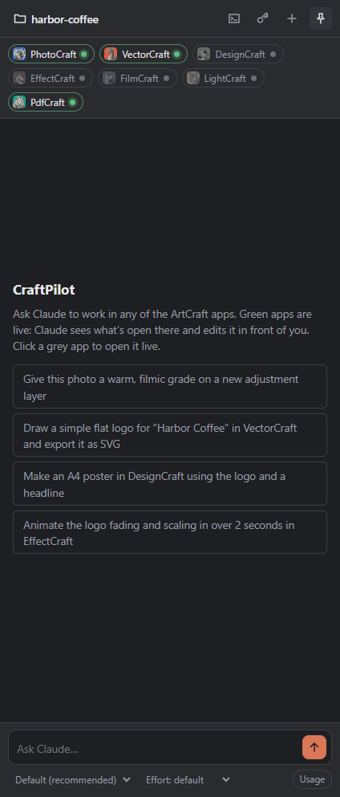
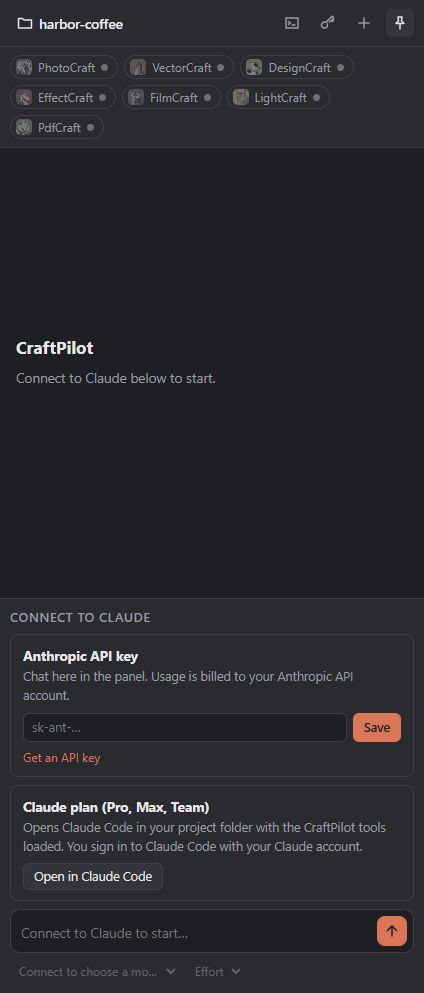

# CraftPilot

**Work in the ArtCraft creative apps with Claude.** CraftPilot is a chat panel that docks beside
[PhotoCraft, VectorCraft, DesignCraft, EffectCraft, FilmCraft, LightCraft and PdfCraft](https://getartcraft.com/apps).
Claude sees what's open in each app, makes edits live in the app's own window, and can move
work between apps, for example from a vector logo to a poster layout to a finished PDF.

CraftPilot also comes as a plugin for [Claude Code](https://claude.com/product/claude-code), for
people who prefer to work in a terminal or who use a Claude plan.

<p align="center">
  
  &nbsp;&nbsp;
  
</p>

> CraftPilot is an independent project. It is not made, endorsed or supported by the ArtCraft
> Team or by Anthropic. "ArtCraft", "PhotoCraft" and the other app names belong to their owners
> and are used here only to say which apps CraftPilot works with.

## Features

- **Live editing:** edits appear in the app windows as they happen. Each one is an ordinary
  step in the app's undo history.
- **Context:** every message tells Claude what's open in each live app (document, layers,
  selection, page and so on), so you can just say "this photo" or "the selected layer".
- **All seven apps:** photo editing, vector illustration, page layout, motion graphics, video
  editing, photo library and raw development, and PDFs.
- **Works across apps:** Claude hands work from one app to the next through files in your
  project folder.
- **Background work:** apps that aren't open still work headless. Claude edits their files in
  the background, and documents stay open between messages.
- **Project folder:** CraftPilot works inside one folder you choose.
  - Apps that support it are locked to that folder.
  - For the others, CraftPilot asks before Claude uses a path outside it.
- **Your approval:** app edits and file reads run straight away. Anything else, such as shell
  commands or writing files, asks first.
- **Model, effort and usage:** choose the Claude model and effort level, and see context-window
  use and estimated cost.

## Requirements

- **Windows 10 or 11** (x64). The Claude Code plugin also runs on macOS and Linux, but it is
  only tested on Windows.
- **One or more ArtCraft apps.** Install them with the
  [ArtCraft Launcher](https://getartcraft.com/apps). CraftPilot finds them in
  `C:\Program Files\<App>`; elsewhere, set `<APP>_HOME`, e.g. `VECTORCRAFT_HOME`.
- **[Claude Code](https://claude.com/product/claude-code)**, installed. CraftPilot uses it to
  talk to Claude.
- **Either** an [Anthropic API key](https://console.anthropic.com/settings/keys), to chat in the
  panel, **or** a Claude plan (Pro, Max, Team) signed in to Claude Code, to use the Claude Code
  plugin.
- **Node.js 18 or newer**, only for the Claude Code plugin route.

## Install

Download the latest build from the [Releases page](../../releases/latest):

- **`CraftPilot-Setup-<version>.exe`** (recommended): installs CraftPilot for your Windows
  account in `%LOCALAPPDATA%\Programs\craftpilot`. It needs no admin rights and adds a
  Start-menu entry and an uninstaller.
- **`CraftPilot-<version>-portable.exe`**: a single file you run without installing. It starts
  more slowly, because it unpacks itself each time.

Both keep your settings in `%APPDATA%\CraftPilot`, so they share them. To update, run the new
installer or swap in the new portable file.

The builds aren't code-signed yet, so Windows SmartScreen may warn the first time you run one.
Choose **More info → Run anyway**.

**Uninstalling:** remove CraftPilot under Windows **Settings → Apps**, or delete the portable
file. Your settings and encrypted API key stay in `%APPDATA%\CraftPilot`; delete that folder to
remove them too.

## Getting started

1. **Choose a project folder.** Click the folder name at the top left. Claude and the apps work
   inside this folder.
2. **Connect to Claude.** Pick one:
   - **API key:** paste your Anthropic API key and press **Save**. You can then chat in the
     panel; usage is billed to your Anthropic API account. The key is encrypted with Windows'
     data protection and stored only on your PC. To change or remove it, use the key button in
     the header.
   - **Claude plan:** press **Open in Claude Code**, or the terminal button in the header.
     Claude Code opens in your project folder with CraftPilot's tools loaded, and you sign in to
     Claude Code with your Claude account.
3. **Open the apps you need.** Click an app chip to open it with live control for your project:

   | Chip | Meaning |
   |---|---|
   | 🟢 Green | Live: Claude works in this window |
   | ⚪ Grey | Not open: click to open it live; meanwhile Claude works on files in the background |
   | 🟠 Amber | Open without CraftPilot, or for another project folder: save, close the app, then click again |

4. **Ask.** For example:
   - *"Give this photo a warm, filmic grade on a new adjustment layer."*
   - *"Draw a flat logo for Harbor Coffee in VectorCraft and export it as SVG."*
   - *"Make an A4 poster in DesignCraft with the logo and a headline, then export a PDF."*
   - *"Rotate page 2 of the brochure and show it in PdfCraft."*

   Press **Ctrl+Z** in an app to undo Claude's last step there.

### The panel

| Control | Where | What it does |
|---|---|---|
| Project folder | Top left | Choose the folder CraftPilot works in |
| Terminal button | Header | Open Claude Code in the project with CraftPilot loaded |
| Key button | Header | Add, change or remove your API key |
| **+** | Header | Start a new chat |
| Pin | Header | Keep the panel on top of other windows |
| Model, Effort | Under the chat box | Choose the Claude model and how much effort it puts in |
| Usage chip | Under the chat box | Context-window use and the chat's estimated cost |

## Using CraftPilot from Claude Code

CraftPilot's tools also install as a Claude Code plugin, so you can use them from any terminal
or IDE where you run Claude Code:

```bash
claude plugin marketplace add Rudivw-sponge/craftpilot
claude plugin install craftpilot@craftpilot
```

Then, in your project folder:

- **`/craftpilot:open <app> [file]`** opens an app with live control for this folder, for example
  `/craftpilot:open vectorcraft logo.svg`. Afterwards, run `/mcp` and reconnect that app.
- **Ask for edits.** A shared `craftpilot` skill sets the ground rules, and there is one skill per
  app.
- **`CRAFTPILOT_MODE=headless`** keeps every app in background mode.

## Troubleshooting

| Problem | What to do |
|---|---|
| An app chip is **amber** | The app is open without CraftPilot, or for another project folder. Save your work, close the app, then click its chip. |
| An app is **missing** from the chips | CraftPilot looks in `C:\Program Files\<App>` and `%LOCALAPPDATA%\Programs\<App>`. If it's elsewhere, set `<APP>_HOME` (e.g. `VECTORCRAFT_HOME`) to the folder containing `<app>-cli.exe`. |
| "Claude Code isn't installed" | Install [Claude Code](https://claude.com/product/claude-code) and restart CraftPilot. If it's in an unusual place, set `CLAUDE_CODE_PATH` to `claude.exe`. |
| "Invalid API key" | Use the key button to paste a current key from the [Anthropic Console](https://console.anthropic.com/settings/keys). |
| **Open in Claude Code** says Node.js is needed | Install [Node.js](https://nodejs.org) 18 or newer, then try again. |
| In Claude Code, an app stays headless after `/craftpilot:open` | Run `/mcp` and reconnect that app's server. |
| Windows SmartScreen blocks the download | The builds aren't code-signed. Choose **More info → Run anyway**. |

## Privacy and safety

- **Your API key** is encrypted with Windows' own data protection (DPAPI) and stored in
  `%APPDATA%\CraftPilot`.
- **No sign-in fallback:** the panel runs Claude Code with a configuration of its own, so it
  only ever uses your API key, never another sign-in on your PC.
- **Where your work goes:** CraftPilot sends nothing anywhere except to Anthropic, through
  Claude Code, as part of your chats.
- **The apps' control connections** only accept connections from your own PC. PhotoCraft and
  PdfCraft also require a token. The other apps' control ports have no password, so any program
  on your PC can use them while they're open with live control.
- **LightCraft** works on your real photo library. Claude is instructed to ask before deleting
  photos or changing many at once.

## How it works

Each ArtCraft app ships its own MCP server (`<app>-cli mcp`) and a local control channel for
its window. CraftPilot starts each installed app's server, live when the app is open for your
project and headless otherwise, and gives them to Claude through the
[Claude Agent SDK](https://code.claude.com/docs/en/agent-sdk/overview). See
[docs/architecture.md](docs/architecture.md) for the details.

## Building from source

```bash
git clone https://github.com/Rudivw-sponge/craftpilot.git
cd craftpilot
npm install
npm start
```

- **`npm start`:** runs the app from source.
- **`npm run dist`:** builds the installer and the portable exe into `dist/`.
- **Releases:** a GitHub Actions workflow builds and attaches them whenever a `v*` tag is
  pushed. See [docs/releasing.md](docs/releasing.md) for the steps.
- **`node scripts/third-party-notices.js`:** regenerates `THIRD_PARTY_NOTICES.md` after
  dependency changes.

## Licence

CraftPilot is free and open source under the [MIT licence](LICENSE): use it, change it, share it or
build on it however you like, as long as the licence notice stays with it. It bundles
third-party software and the ArtCraft app icons, each under its own licence; see
[THIRD_PARTY_NOTICES.md](THIRD_PARTY_NOTICES.md). Use of Claude is subject to
[Anthropic's terms](https://code.claude.com/docs/en/legal-and-compliance).

## Credits

Built by Rudi van Wyk, with Claude Opus 5.5 in Claude Code.
